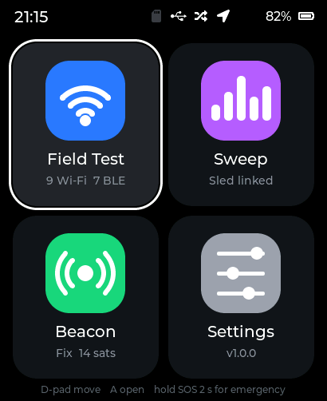
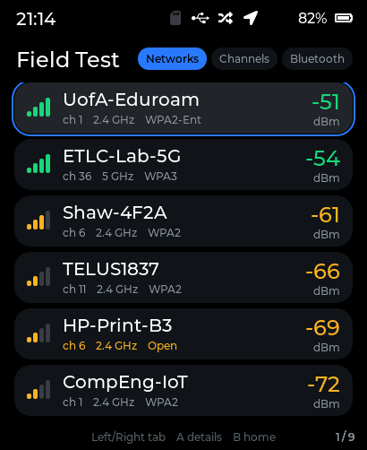
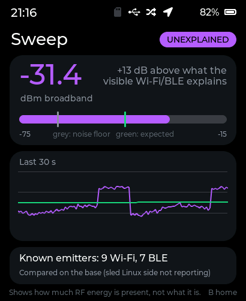
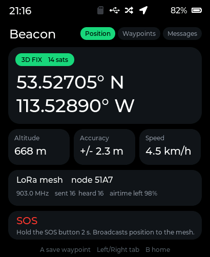

# Signal Scout

A pocket RF field instrument: Wi-Fi/Bluetooth diagnostics, broadband RF presence sensing and a GPS + LoRa mesh safety beacon in one handheld. Hardware, enclosure and firmware live in this repository.

| Home | Field Test | Sweep | Beacon |
|---|---|---|---|
|  |  |  |  |

More screens: [docs/screenshots](docs/screenshots). They are rendered by the simulator from the same UI code that runs on the device.

## Hardware

**Base unit** (`SignalScout_Base/`, 46 x 82 mm, 4-layer)

| Function | Part |
|---|---|
| MCU | ESP32-S3-WROOM-1-N16R8 |
| Display | TOQ206XVT-01 2.06" AMOLED, QSPI |
| LoRa | Ebyte E22-900M22S (SX1262), 915 MHz |
| GNSS | u-blox MAX-M10S |
| Inputs | D-pad, A, B, side, SOS, lock slide switch (AW9523B expander) |
| Sensors | LSM6DSO IMU, BME280 |
| Feedback | DRV2605L + LRA, PAM8904 + piezo siren, RGB LED |
| Power | BQ24074 charger, MAX17048 fuel gauge, TPS63001 3.3 V |
| I/O | microSD, Qwiic, USB-C, pogo link to the sled |

**Sled** (`SignalScout_Sled.kicad_pcb`): carries the Arduino UNO Q and an AD8317 log detector (1 MHz to 10 GHz) on a U.FL antenna, plus its own battery, charger and 5 V boost. It links to the base through pogo pins: UART, I2C (sled ID EEPROM and fuel gauge) and a wake line.

**Enclosure**: `enclosure/` (STEP and STL).

### Pin map

Generated from the KiCad boards by `tools/gen_pins.py`, which also writes `firmware/include/pins.h`. The board files are the source of truth.

<!-- PINMAP:BEGIN -->
#### ESP32-S3-WROOM-1 (base board U1)

| Net | Module pad | GPIO | Note |
|---|---|---|---|
| `SD_CS` | 27 | IO0 | Strapping pin: boot mode |
| `LORA_RXEN` | 39 | IO1 |  |
| `GNSS_TXD` | 38 | IO2 |  |
| `SIREN_PWM` | 15 | IO3 | Strapping pin: JTAG select |
| `I2C_SDA` | 4 | IO4 |  |
| `I2C_SCL` | 5 | IO5 |  |
| `TP_INT` | 6 | IO6 |  |
| `DISP_TE` | 7 | IO7 |  |
| `DISP_RESET` | 12 | IO8 |  |
| `LCD_D3` | 17 | IO9 |  |
| `LCD_CS` | 18 | IO10 |  |
| `LCD_D0` | 19 | IO11 |  |
| `LCD_SCK` | 20 | IO12 |  |
| `LCD_D1` | 21 | IO13 |  |
| `LCD_D2` | 22 | IO14 |  |
| `EXP_INT` | 8 | IO15 |  |
| `SPI_MISO` | 9 | IO16 |  |
| `SPI_MOSI` | 10 | IO17 |  |
| `SPI_SCK` | 11 | IO18 |  |
| `USB_D-` | 13 | IO19 |  |
| `USB_D+` | 14 | IO20 |  |
| `KEY_SOS` | 23 | IO21 |  |
| `LORA_NSS` | 31 | IO38 |  |
| `LORA_BUSY` | 32 | IO39 |  |
| `LORA_DIO1` | 33 | IO40 |  |
| `LORA_NRST` | 34 | IO41 |  |
| `GNSS_RXD` | 35 | IO42 |  |
| `SLED_TX` | 37 | IO43 |  |
| `SLED_RX` | 36 | IO44 |  |
| `HAPTIC_EN` | 26 | IO45 | Strapping pin: VDD_SPI voltage |
| `SIREN_EN` | 16 | IO46 | Strapping pin: boot mode / ROM log |
| `SLED_SDA` | 24 | IO47 |  |
| `SLED_SCL` | 25 | IO48 |  |

#### AW9523B I/O expander (base board U4, I2C 0x58)

| Net | Port pin |
|---|---|
| `KEY_UP` | P0_0 |
| `KEY_DOWN` | P0_1 |
| `KEY_LEFT` | P0_2 |
| `KEY_RIGHT` | P0_3 |
| `KEY_A` | P0_4 |
| `KEY_B` | P0_5 |
| `SPARE_IO` | P0_6 |
| `KEY_SIDE` | P0_7 |
| `KEY_LOCK` | P1_0 |
| `CHG_N` | P1_1 |
| `SLED_WAKE` | P1_2 |
| `DISP_PWR_EN` | P1_3 |
| `GNSS_RST` | P1_4 |
| `LED_RK` | P1_5 |
| `LED_GK` | P1_6 |
| `LED_BK` | P1_7 |

#### UNO Q headers (sled A1)

| Net | UNO pin |
|---|---|
| `AD_VOUT` | A0 |
| `UNOQ_RX` | D0 |
| `UNOQ_TX` | D1 |
| `UNOQ_WAKE` | D2 |
<!-- PINMAP:END -->

## What it does

**Field Test** scans Wi-Fi and Bluetooth LE passively. Networks are listed by signal strength with channel, band and security. The Channels tab shows 2.4 GHz channel load and the least congested of channels 1/6/11. Press A on a network for its details and a signal-over-time graph.

**Sweep** shows the broadband RF level from the sled's detector as a number, a meter and a 30-second history. The level is compared with the Wi-Fi/BLE emitters the unit can see:

- *Quiet*: at the noise floor.
- *Explained*: consistent with the visible Wi-Fi/BLE activity.
- *Unexplained*: clearly more energy than the visible emitters account for.

It reports how much energy is present, not what the source is. The detector is broadband, so it cannot tell frequency or identify a transmitter.

**Beacon** shows the GNSS fix, saves waypoints, and points back to a saved waypoint with distance and bearing. It sends short text messages over a LoRa mesh (no subscription, peer to peer). Holding the SOS button for 2 seconds broadcasts the position to the mesh every 20 seconds and sounds the siren; hold again to cancel. SOS works from any screen and with the lock switch on.

**Also**: status bar (battery, charge state, GNSS, LoRa, sled, time from GNSS), settings (brightness, haptics, siren, units, LoRa channel and power, GPS power save, microSD logging), key lock on the slide switch, deep sleep, CSV logs on the card.

**Scope**: receive and analyse, plus the unit's own LoRa messages. The firmware has no deauthentication, jamming or spoofing features.

### Controls

| Control | Action |
|---|---|
| D-pad | Move focus; Left/Right switch tabs or change a setting |
| A | Select |
| B | Back |
| Side button | Home |
| SOS (hold 2 s) | Start or cancel SOS |
| Lock switch | Ignore keys (SOS still works) |

## Repository layout

| Path | Contents |
|---|---|
| `firmware/` | ESP32-S3 firmware, simulator and unit tests (PlatformIO) |
| `firmware/lib/ss_core` | Portable logic: pogo protocol, mesh, correlation, battery, geo, UBX |
| `firmware/lib/ss_services` | Services, one per subsystem, running on the HAL |
| `firmware/lib/ss_ui` | LVGL 9 user interface |
| `firmware/lib/ss_mock` | Mock for every HAL interface (simulator and tests) |
| `firmware/src/device` | ESP32-S3 drivers and FreeRTOS tasks |
| `firmware/src/sim` | Desktop simulator and screenshot renderer |
| `sled/signalscout_sled` | Arduino App Lab app for the UNO Q (sketch + Python) |
| `docs/` | [Bring-up checklist](docs/BRINGUP.md), [protocol](docs/PROTOCOL.md), [hardware-verification list](docs/TODO.md), [pin map](docs/PINMAP.md) |
| `tools/` | Pin-map generator, shared-file sync, test-vector generator |

## Firmware design

- **PlatformIO + Arduino-ESP32.** The Arduino core gives working Wi-Fi scan, NimBLE, SD and RadioLib support with little glue. The one place where it would cost performance, the QSPI display, uses the ESP-IDF SPI driver directly (`src/device/display.cpp`), which the Arduino core exposes.
- **HAL.** `lib/ss_core/hal.h` has one interface per peripheral. Device implementations are in `src/device`, mocks in `lib/ss_mock`.
- **Services.** One per subsystem (input, housekeeping, scan, sweep, GNSS, mesh, storage). On the device each runs in its own FreeRTOS task.
- **Message bus.** The UI pops `Event`s and pushes `Cmd`s and never touches a driver or a service.
- **LoRa mesh.** RadioLib SX1262 at 500 kHz bandwidth, SF9. Managed flooding with a hop limit, duplicate suppression, random relay delay, SOS priority and a self-imposed 10 % airtime budget (SOS may exceed it).
- **GNSS.** UBX only: CFG-VALSET at boot (NAV-PVT at 1 Hz, GPS + Galileo + BeiDou, optional power save).
- **Sled.** The STM32 samples the detector and streams it to the base. The Linux side scans Wi-Fi/BLE and sends a verdict. If the Linux side is not running, the base runs the same comparison on its own scan.

## Build and flash

Install [PlatformIO Core](https://docs.platformio.org/en/latest/core/installation/index.html), then from `firmware/`:

```sh
pio run -e device                 # build
pio run -e device -t upload       # flash over USB-C
pio device monitor                # serial log (USB CDC)
pio test -e native                # unit tests on the host
pio run -e sim                    # simulator (needs libsdl2-dev)
.pio/build/sim/program            # interactive: arrows, Z = A, X = B, H = side, S = SOS, L = lock
.pio/build/sim/program --shots ../docs/screenshots
```

If the board does not enter the bootloader by itself, hold BOOT, tap EN, release BOOT.

A plain CMake build of the tests and simulator is also available (`firmware/CMakeLists.txt`).

**Sled**: open `sled/signalscout_sled` in Arduino App Lab and run it on the UNO Q. Run `python3 tools/sync_shared.py` first if you changed `proto.h`.

After a hardware change run `python3 tools/gen_pins.py`. Do not edit `pins.h` by hand.

## Status and known limitations

The logic, UI and protocol are tested on the host (30 firmware tests, 7 sled tests) and the device firmware builds in CI. **Nothing here has run on the real boards yet.** Follow [docs/BRINGUP.md](docs/BRINGUP.md) for first power-on; [docs/TODO.md](docs/TODO.md) lists what needs hardware to confirm.

- The display driver assumes the panel uses a CO5300 controller at 410 x 502 with a 22-column offset. Confirm against the panel datasheet.
- The Sweep detector is broadband and uncalibrated until the constants in the sled sketch are set against a known source.
- The navigation arrow uses GPS course over ground, so it only settles while moving. There is no magnetometer.
- Messages are canned quick replies; there is no keyboard.
- The touch layer of the panel is not used.
- LoRa settings target the 902 to 928 MHz band (Canada/US). Check local rules before using it elsewhere.
